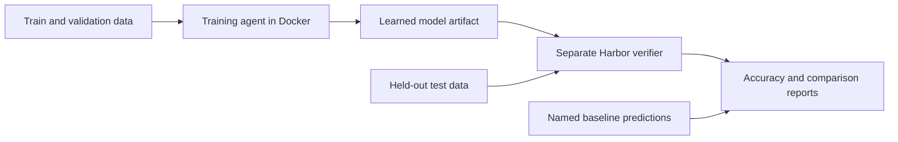

# Vision RL Lab

[](https://github.com/RyanLin5967/RyanLinEnv/actions/workflows/ci.yml)

Train specialist vision models for tasks where general models struggle, then compare them on the same held-out examples. Docker supplies the environment, Harbor runs the training agent and independent verifier, and the training backends update model weights from correctness rewards.

This is an **independent Roboflow Labs onboarding and learning project** inspired by its public work on visual capability gaps. It includes a small CPU exercise, a real-image counting specialist, and a CUDA path for training vision-language adapters on your own data. It does not claim a frontier-model win without measured evidence.

## Start locally

Install [uv](https://docs.astral.sh/uv/getting-started/installation/), then from the repository root:

```bash
uv sync --extra harbor --extra dev
uv run vision-rl demo --output runs/demo
```

The demo requires no GPU, API key, or model download. It trains a spatial policy with REINFORCE and selects a candidate using validation. Open `runs/demo/summary.json` and `comparison.json`; training histories and the learned checkpoint are under `runs/demo/training/`. Use a fresh output directory for another run.

The CPU demo uses a fixed color-centroid encoder and a learned linear policy. It is an exercise in real policy-gradient learning, with an untrained policy as its baseline. Results are not HSS scores or evidence that a frontier model struggles on these generated images.

## Docker and Harbor

With a running Docker daemon:

```bash
docker build -t vision-rl:local .
docker compose run --rm demo
uv run harbor run -p tasks/spatial-specialist \
  --agent vision_rl.harbor_agent:TrainingAgent
```

Compose saves its results to `runs/docker-demo`. Harbor saves jobs under `jobs/`. Its separate verifier creates fresh test images and grades the submitted numeric model artifact. `--agent oracle` runs the reference solution; `--agent nop` checks the empty-submission control.

For real-image counting manifests, package and run a CPU training task:

```bash
docker build -f Dockerfile.vision -t vision-rl:vision .
uv run vision-rl make-count-task \
  --train data/custom/train.jsonl --validation data/custom/validation.jsonl \
  --test data/custom/test.jsonl --output runs/count-task
uv run harbor run -p runs/count-task \
  --agent vision_rl.harbor_agent:CountTrainingAgent
```

The base image caches the frozen vision encoder at build time. Training runs without network access. Test images stay outside the training image, and a separate verifier grades the submitted head using its own fixed encoder.



## Use your own data and models

- **Roboflow:** list workspace projects, download a version, and import classification folders or COCO annotations as image questions. Credentials stay in your environment or ignored `.env`.
- **Real-image counting:** train a head over frozen ResNet18 features with a supervised warm start and REINFORCE. Runs on CPU, Apple MPS, or CUDA with the separate `requirements-vision.txt` environment; compare its RL and supervised checkpoints.
- **VLM training:** run GRPO with LoRA on a supported pretrained vision-language model using a Linux NVIDIA GPU. The optional stack is in `requirements-vlm.txt`; `Dockerfile.gpu` packages it.
- **Custom Harbor tasks:** `make-count-task` runs `CountTrainingAgent` on CPU; `make-vlm-task` runs `VLMTrainingAgent` on GPU. Both keep test data outside the training image and use separate verifiers.
- **Benchmarking:** evaluate a checkpoint, a VLM adapter, a multimodal `/chat/completions` endpoint, or saved predictions. Compare matched results with paired bootstrap intervals and retain request failures.
- **Frontier models through Roboflow:** `python -m vision_rl.roboflow_inference` evaluates Gemini through Roboflow credits using `ROBOFLOW_API_KEY`, retaining native model identity and usage alongside scored predictions.

For example, after preparing image-question manifests and installing the CUDA dependencies:

```bash
source .venv/bin/activate
python -m vision_rl.vlm --preflight
python -m vision_rl.vlm \
  --train data/custom/train.jsonl --validation data/custom/validation.jsonl \
  --output runs/vlm --model Qwen/Qwen2.5-VL-3B-Instruct --max-steps 100
vision-rl evaluate --manifest data/custom/test.jsonl \
  --vlm-model Qwen/Qwen2.5-VL-3B-Instruct --adapter runs/vlm/final_adapter \
  --output runs/specialist.json
```

The optional CUDA path is implemented and unit-tested; full GPU training and GPU Harbor execution need validation on a CUDA host. The default CPU exercise runs independently of that stack.

## Imported-label agreement (audit found label-scope errors)

The first experiment used 30 held-out chess-pawn images. Its raw scores measure agreement with imported COCO answers, **not verified visual counting accuracy**:

| Model | Imported-label agreement |
| --- | --- |
| Gemini 4 Argon | 27/30 (90.0%) |
| Supervised specialist | 26/30 (86.7%) |
| Specialist after RL | 25/30 (83.3%) |
| Training-majority baseline | 13/30 (43.3%) |

The audit confirmed two scope errors: prompts asked for all visible pawns, while those annotations counted only on-board pawns and omitted visible off-board pawns. A third suspected omission of an occluded pawn remains under review. Raw scores have not been corrected after the fact. RL matched one fewer imported answer than supervised training; this small, same-domain dataset does not establish an RL benefit or a frontier-model win. See [results and the annotation audit](docs/results.md) for the evidence.

## What counts as a result?

Discover weaknesses on validation, train on training data, freeze the candidate, and evaluate once on an untouched test set. Name the baseline version and inference budget. A claim that a specialist beats a frontier model needs actual baseline predictions under a matching protocol, with uncertainty and errors reported.

**Humanity's Sixth Sense is an open-ended image/video benchmark by Scale AI and Elorian. RF100-VL is a detection benchmark by Roboflow and Carnegie Mellon.** This project's image multiple-choice accuracy is not interchangeable with either benchmark's official score. Native benchmark adapters are future work; their formats and requirements are documented in the research notes.

## Read next

- [Onboarding walkthrough](docs/onboarding.md): CPU exercise, Docker/Harbor, Roboflow import, GPU training, and comparisons.
- [Research and benchmark choices](docs/research.md): verified Roboflow Labs/Agent announcements and official HSS/RF100-VL sources.
- [Measured results and validation](docs/results.md): executed experiments, exact scope, and remaining hardware limitations.

```bash
uv run pytest -q
uv run ruff check .
```
