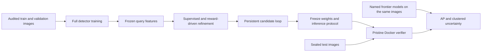
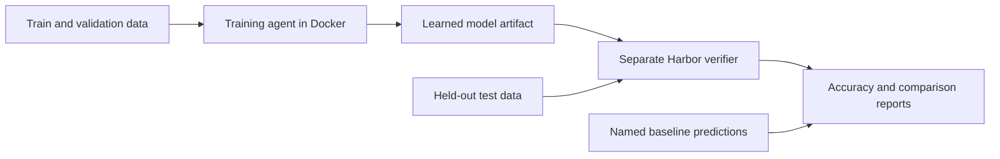

# Vision RL Lab

[](https://github.com/RyanLin5967/RyanLinEnv/actions/workflows/ci.yml)

Train specialist vision models for tasks where general models struggle, then compare them on the same held-out examples. Docker supplies the environment, Harbor runs the training agent and independent verifier, and the training backends update model weights from correctness rewards.

This is an **independent Roboflow Labs onboarding and learning project** inspired by its public work on visual capability gaps. Its detection pipeline fine-tunes a complete RF-DETR transformer, trains a reward-driven box refinement policy, and measures native COCO average precision against live frontier models. A small CPU exercise introduces the same training and verification workflow.

The experiment controller journals candidate runs, resumes interrupted work, selects using validation, freezes model and inference settings, and reserves final evaluation once. Real training, inference, and pristine-container verification are required alongside the software tests.

## Train a full vision specialist

The detector backend updates approximately **30 million parameters** in RF-DETR Nano. Its separate refinement policy learns box corrections and confidence from sampled detection rewards. Reports keep the detector, supervised refinement, and RL stages separate so supervised gains cannot be presented as an RL improvement.

```bash
uv venv --python 3.12 .venv-detection
uv pip install --python .venv-detection/bin/python -r requirements-detection.txt

# Public, versioned RF100-VL dataset; uses ROBOFLOW_API_KEY from your environment/.env.
.venv-detection/bin/python scripts/prepare_pills.py --download
.venv-detection/bin/python -m vision_rl.detection_training \
  --source data/rf100vl-pills/clean-coco \
  --output runs/my-detector --device mps
```

Use `--device cuda` on a suitable NVIDIA host or `--device cpu` for a small exercise. Full training on this project uses local Apple MPS; Docker runs the CPU verifier. See the [detection walkthrough](docs/detection-onboarding.md) for query caches, RL training, the persistent experiment loop, frontier comparisons, and your own COCO data.

The complete development recipe runs detector training at 384 pixels, a progressive 512-pixel stage, refinement candidates, and independent validation through one persistent controller:

```bash
.venv-detection/bin/python -m vision_rl.detection_recipe run \
  --source data/rf100vl-pills/clean-coco \
  --recipe recipes/detection-progressive.json \
  --state-dir runs/full-recipe --background
.venv-detection/bin/python -m vision_rl.detection_recipe status \
  --state-dir runs/full-recipe
```

The example recipe defaults to CPU; set `detector.device` to `mps` or `cuda` in your copy for accelerated training. Completed stages are reused on resume, with configuration, weights, source, package versions, and input bytes checked. The controller stops before final test evaluation. An imported trained pipeline can use the same validation and freezing path without claiming that its weights were trained by that run.

The native benchmark is **one RF100-VL dataset**, pill detection, with 1,449 training, 423 validation, and 200 test images in the downloaded export. Its score is COCO AP50:95 with a 500-detection limit. Capture hours overlap across the native splits; uncertainty is clustered by inferred capture hour, and results describe this within-capture benchmark. They do not establish generalization to new capture sessions or a score across all 100 RF100-VL datasets.

The [completed 512-pixel development run](reports/2026-10-16-progressive512-development/README.md) reaches **92.75% AP** across all 423 validation images, versus **90.09%** for the 384-pixel detector and **91.93%** with its supervised crop refiner. The 512-pixel gain over the 384-pixel detector is **2.66 AP points**, with a paired capture-group 95% interval of **[1.42, 3.48]** points. Its 12 additional training epochs took **36.60 minutes** on the local M5 Pro, excluding setup.

The [Nano512 model card](models/pills-nano512/README.md) provides the numeric weights, SHA-256, exact foreground mapping and an offline inference command. This publishes the measured supervised checkpoint separately from the ongoing RL experiments.

On the same 48 discovery images used by the frontier models, the 512-pixel detector scores **90.64%** and the 384-pixel crop pipeline **90.91%**, versus **73.19% for Gemini 4 Argon high**, **72.82% for GPT-6 Astra high**, **64.57% for Kimi K3**, **57.52% for Qwen3.8-27B**, and **54.35% for Claude Opus 5.5**. The 512-pixel advantage over the strongest measured Gemini configuration is **17.45 points**, with a paired interval of **[13.56, 21.60]** points. The [earlier controlled report](reports/2026-10-16-controlled-rl-development/README.md) preserves all provider configurations and Qwen's documented parser correction, applied consistently to every provider's original responses.

These are development results. The intended 20-point advantage over every baseline is not established, and the final 200-image test remains sealed. The strongest completed query policy improved only **0.029 AP points** over its supervised control. Two subsequent direct-detector RL exploration pilots failed their preregistered threshold. Supervised gains are not counted as RL gains. Both failed pilots, corrected baselines, credit-exhausted incomplete runs, and executed Docker/Harbor evidence remain available; the [first detection snapshot](reports/2026-10-16-pill-development/README.md) is also preserved.

The subsequent experiment uses [public wheat images with disjoint acquisition domains](docs/wheat-data-audit-2026-10-16.md). Its [controlled RL protocol](docs/wheat-direct-rl-protocol-v1.json) trains the detector's decoder and prediction heads directly from the official WILDS detection-accuracy reward. It requires a train-only exploration check, identical initialization and image draws, both equal-update and equal-active-time supervised controls, and at least a **five-point equal-domain accuracy gain** with a positive paired uncertainty bound. The dataset is the separately named author-Hugging-Face protocol; no WILDS-native or competition-leaderboard equivalence is claimed.

The [wheat learning attempt](docs/wheat-direct-rl-outcome-2026-10-16.md) did not pass. After 20 saved RL updates, independently evaluated equal-domain accuracy decreased from **65.21% to 64.83%** on all 1,476 validation images under the same calibration search. The run then rejected a trust-region proposal; the independent drift check also failed. The planned 64-update comparison and matched controls were not completed. The observed training reward gain came from confidence changes, with no geometry-only reward gain on the fixed diagnostic images. This evidence ends the current Gaussian-detector experiment; it does not establish that other RL methods cannot improve wheat detection.

The next candidate is token-based VLM reinforcement learning on public fine-grained Aircraft classification. Its [data preparation](docs/fgvc-aircraft-image-preparation-2026-10-16.md) fixes four native training images per class, **400 images across all 100 variants**, before training. The original-image and complete cross-split checks remain pending; a separate 16-image training probe checks model inputs, answer formatting and runtime. The [strategy review](docs/rl-strategy-review-2026-10-16.md) distinguishes this adaptation from published experiments and documents why their permissive substring scorer is not directly comparable with our exact-label metric. No Aircraft learning or frontier-win result is established yet.



## Start locally

Install [uv](https://docs.astral.sh/uv/getting-started/installation/), then from the repository root:

```bash
uv sync --extra harbor --extra dev
uv run vision-rl demo --output runs/demo
```

The demo requires no GPU, API key, or model download. It trains a spatial policy with REINFORCE and selects a candidate using validation. Open `runs/demo/summary.json` and `comparison.json`; training histories and the learned checkpoint are under `runs/demo/training/`. Use a fresh output directory for another run.

The CPU demo uses a fixed color-centroid encoder and a learned linear policy. It is an exercise in real policy-gradient learning, with an untrained policy as its baseline. Results are not HSS scores or evidence that a frontier model struggles on these generated images.

## Docker and Harbor

With a running Docker daemon:

```bash
docker build -t vision-rl:local .
docker compose run --rm demo
uv run harbor run -p tasks/spatial-specialist \
  --agent vision_rl.harbor_agent:TrainingAgent
```

Compose saves its results to `runs/docker-demo`. Harbor saves jobs under `jobs/`. Its separate verifier creates fresh test images and grades the submitted numeric model artifact. `--agent oracle` runs the reference solution; `--agent nop` checks the empty-submission control.

For real-image counting manifests, package and run a CPU training task:

```bash
docker build -f Dockerfile.vision -t vision-rl:vision .
uv run vision-rl make-count-task \
  --train data/custom/train.jsonl --validation data/custom/validation.jsonl \
  --test data/custom/test.jsonl --output runs/count-task
uv run harbor run -p runs/count-task \
  --agent vision_rl.harbor_agent:CountTrainingAgent
```

The base image caches the frozen vision encoder at build time. Training runs without network access. Test images stay outside the training image, and a separate verifier grades the submitted head using its own fixed encoder.



## Use your own data and models

- **Roboflow:** list workspace projects, download a version, and import classification folders or COCO annotations as image questions. Credentials stay in your environment or ignored `.env`.
- **Native object detection:** fine-tune RF-DETR on COCO data, train a contextual refinement policy, evaluate native detection AP, and package numeric model artifacts for the independent Harbor verifier. `make-detection-task` runs `DetectionTrainingAgent`.
- **Real-image counting:** train a head over frozen ResNet18 features with a supervised warm start and REINFORCE. Runs on CPU, Apple MPS, or CUDA with the separate `requirements-vision.txt` environment; compare its RL and supervised checkpoints.
- **VLM training:** run GRPO with LoRA on a supported pretrained vision-language model using a Linux NVIDIA GPU. The optional stack is in `requirements-vlm.txt`; `Dockerfile.gpu` packages it.
- **Custom Harbor tasks:** `make-count-task` runs `CountTrainingAgent` on CPU; `make-vlm-task` runs `VLMTrainingAgent` on GPU. Both keep test data outside the training image and use separate verifiers.
- **Benchmarking:** evaluate a checkpoint, a VLM adapter, a multimodal `/chat/completions` endpoint, or saved predictions. Compare matched results with paired bootstrap intervals and retain request failures.
- **Frontier models through Roboflow:** `python -m vision_rl.roboflow_inference` evaluates Gemini through Roboflow credits using `ROBOFLOW_API_KEY`, retaining native model identity and usage alongside scored predictions.

For example, after preparing image-question manifests and installing the CUDA dependencies:

```bash
source .venv/bin/activate
python -m vision_rl.vlm --preflight
python -m vision_rl.vlm \
  --train data/custom/train.jsonl --validation data/custom/validation.jsonl \
  --output runs/vlm --model Qwen/Qwen2.5-VL-3B-Instruct --max-steps 100
vision-rl evaluate --manifest data/custom/test.jsonl \
  --vlm-model Qwen/Qwen2.5-VL-3B-Instruct --adapter runs/vlm/final_adapter \
  --output runs/specialist.json
```

The optional CUDA path is implemented and unit-tested; full GPU training and GPU Harbor execution need validation on a CUDA host. The default CPU exercise runs independently of that stack.

## Imported-label agreement (audit found label-scope errors)

The first experiment used 30 held-out chess-pawn images. Its raw scores measure agreement with imported COCO answers, **not verified visual counting accuracy**:

| Model | Imported-label agreement |
| --- | --- |
| Gemini 4 Argon | 27/30 (90.0%) |
| Supervised specialist | 26/30 (86.7%) |
| Specialist after RL | 25/30 (83.3%) |
| Training-majority baseline | 13/30 (43.3%) |

The audit confirmed two scope errors: prompts asked for all visible pawns, while those annotations counted only on-board pawns and omitted visible off-board pawns. A third suspected omission of an occluded pawn remains under review. Raw scores have not been corrected after the fact. RL matched one fewer imported answer than supervised training; this small, same-domain dataset does not establish an RL benefit or a frontier-model win. See [results and the annotation audit](docs/results.md) for the evidence.

## What counts as a result?

Discover weaknesses on validation, train on training data, freeze the candidate, and evaluate once on an untouched test set. Name the baseline version and inference budget. A claim that a specialist beats a frontier model needs actual baseline predictions under a matching protocol, with uncertainty and errors reported.

**Humanity's Sixth Sense is an open-ended image/video benchmark by Scale AI and Elorian. RF100-VL is a detection benchmark by Roboflow and Carnegie Mellon.** The detector pipeline implements native COCO AP for individual RF100-VL datasets. The separate image multiple-choice exercises are not interchangeable with either benchmark's official score. An HSS adapter still requires its own media and rubric evaluation protocol.

## Read next

- [Onboarding walkthrough](docs/onboarding.md): CPU exercise, Docker/Harbor, Roboflow import, GPU training, and comparisons.
- [Full detector and RL walkthrough](docs/detection-onboarding.md): RF-DETR, native AP, resumable experiments, frozen comparisons, and safe Harbor submissions.
- [Detection research and design](docs/detection-research.md): primary sources, objective design, and dataset limitations.
- [Research and benchmark choices](docs/research.md): verified Roboflow Labs/Agent announcements and official HSS/RF100-VL sources.
- [Measured results and validation](docs/results.md): executed experiments, exact scope, and remaining hardware limitations.

```bash
uv run pytest -q
uv run ruff check .
```
