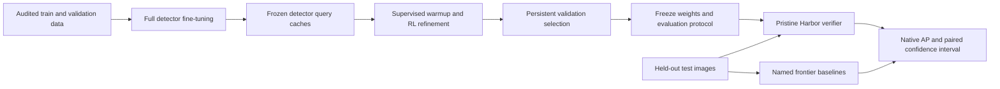

# Train and verify a detection specialist

This walkthrough trains a full RF-DETR detector, then a policy that refines its object queries using reinforcement learning. It also runs frontier baselines on the same native detection task. Docker and Harbor provide an independent verifier; a persistent experiment loop handles development and checkpoint selection.

The implemented Harbor submission contract is **one foreground class, RF-DETR Nano, and 128 retained queries**. You can bring your own COCO data within that contract. Different detector architectures or multiclass refinement require an explicit trainer/verifier extension; the generic experiment runner can schedule other commands, but cannot make an incompatible artifact valid.



## Install the two environments

From the repository root, install the lightweight orchestration environment and an isolated detector environment:

```bash
uv sync --extra harbor --extra dev --extra detection-eval
uv venv .venv-detection --python 3.12
uv pip install --python .venv-detection/bin/python -r requirements-detection.txt
```

The detector environment pins RF-DETR 1.10.0, PyTorch 2.14.1, and its training dependencies. Initial model loading downloads the public initialization. Use `.venv-detection/bin/python` for detector/RL work and `uv run` for Harbor or the lightweight tools.

| Compute | Intended use | Validation status |
| --- | --- | --- |
| Local CPU | Small integration exercises and cached-query RL | Executed |
| Apple MPS outside Docker | Full detector training | Executed on an Apple M5 Pro with 48 GB unified memory |
| Linux CPU Docker | Offline training/verifier integration | Executed through Harbor |
| Linux NVIDIA CUDA | Larger training runs | Implemented; requires a compatible CUDA PyTorch image and NVIDIA container runtime; full CUDA execution remains unverified |

Linux containers on macOS do not receive the Apple MPS accelerator. Running the full dataset in the portable CPU container may take much longer than local MPS training. Leave room for the dataset, model cache, optimizer checkpoints, query caches, and Docker layers; a tiny smoke test does not establish full-run resource requirements.

## Prepare data before training

For the pills experiment, put `ROBOFLOW_API_KEY` in the process environment or an ignored `.env`, then download and audit the pinned version:

```bash
uv run python scripts/prepare_pills.py --download
```

This creates:

```text
data/rf100vl-pills/source/                 downloaded export
data/rf100vl-pills/clean-coco/             audited COCO directories
data/rf100vl-pills/prepared/audit.json     counts, hashes, overlap checks
data/rf100vl-pills/prepared/development/   train/validation JSONL manifests
data/rf100vl-pills/prepared/sealed/        test manifest
runs/pills-audit/                         train/validation contact sheets
```

If the export already exists, omit `--download`. Preparation refuses to overwrite an existing audit directory; preserve the earlier report and choose fresh output paths for a new preparation. The actual export has 1,449/423/200 train/validation/test images. Its metadata totals disagree with actual membership, so use the audit's counts.

For your own dataset, use this layout, with image paths relative to each split:

```text
data/custom/train/_annotations.coco.json
data/custom/train/<images>
data/custom/valid/_annotations.coco.json
data/custom/valid/<images>
data/custom/test/_annotations.coco.json
data/custom/test/<images>
```

COCO boxes are `[x, y, width, height]` in native image pixels. Category IDs and names must agree across splits. The trainer rejects exact file/pixel overlap between train and validation; the task packager checks all three splits. Those checks cannot detect every related crop, burst, patient, or scene. Assign related examples to a single split before training, and review annotation scope on training/validation examples. The [research notes](detection-research.md) explain the native pills capture-hour overlap and the source-frame leakage found in the exploratory stomata dataset.

## Download a published checkpoint

The complete detector exceeds GitHub's ordinary file-size limit, so trained weights belong in release assets with checksums. Once a measured model release is published, select its tag from the [repository releases](https://github.com/RyanLin5967/RyanLinEnv/releases). The placeholder below deliberately does not assert that a release already exists:

```bash
RELEASE_TAG=REPLACE_WITH_PUBLISHED_TAG
gh release download "$RELEASE_TAG" --repo RyanLin5967/RyanLinEnv \
  --dir models/pills-release \
  --pattern model.safetensors --pattern refiner.safetensors \
  --pattern SHA256SUMS --pattern '*.json'

(
  cd models/pills-release
  shasum -a 256 -c SHA256SUMS
)
```

Read `model-card.json` for the exact data, training, result scope, and limitations. If `inference-config.json` is supplied, preserve its resolution, flip, fusion, and refinement settings when reproducing the released score. The safetensors contain numeric weights; inference still uses the installed trusted model code. To try the released model, create the image-only manifest in [the timing section](#measure-inference-before-choosing-an-optimization), then run this single-view example:

```bash
.venv-detection/bin/python -m vision_rl.detection_inference predict \
  --checkpoint models/pills-release/model.safetensors \
  --refinement models/pills-release/refiner.safetensors \
  --manifest runs/timing-images.json \
  --image-root data/rf100vl-pills/clean-coco/valid \
  --category-ids 1 --device cpu --resolutions 384 \
  --output runs/released-model-predictions
```

This example predicts the manifest's validation images. Match any additional release inference settings before comparing its AP with a published result. To reproduce training instead, continue below.

## Train the complete detector

First run a small preflight in its own output directory:

```bash
.venv-detection/bin/python -m vision_rl.detection_training \
  --source data/rf100vl-pills/clean-coco --output runs/detector-preflight \
  --device mps --epochs 1 --batch-size 4 --grad-accum-steps 4 \
  --preflight-batches 8
```

Use `--device cpu --workers 0` on CPU, or `--device cuda` on a configured CUDA host. A preflight limits both training and validation batches; its AP is a plumbing measurement, not the full benchmark score. Include at least two optimizer updates when checking that warmup learning actually changes weights.

Train a fresh full run:

```bash
.venv-detection/bin/python -m vision_rl.detection_training \
  --source data/rf100vl-pills/clean-coco --output runs/detector-nano \
  --architecture nano --device mps --epochs 40 \
  --batch-size 4 --grad-accum-steps 4 --eval-batch-size 8 \
  --workers 2 --cpu-threads 4 --mps-memory-gib 16 --seed 42
```

The measured Nano configuration updates 30,147,076 parameters. Its staged dataset contains train and validation only, and RF-DETR's automatic test evaluation is disabled. Local staging is a convenience for trusted training code, not an OS sandbox. The training plan records configuration, dataset fingerprints, and software versions. `telemetry.jsonl` contains optimizer progress, validation metrics, elapsed time, and memory observations.

The best checkpoint is selected on validation AP with EMA weights. `last.ckpt` retains optimizer and scheduler state; `checkpoint_best_total.pth` is the selected export after training exits cleanly. To resume an interrupted run, repeat the identical command with `--resume`. Changed data, software, or configuration is rejected. A different experiment needs a new output directory.

An optional progressive phase adapts the selected detector at a larger training resolution. Export the 384-pixel model first, then start a separately recorded phase with a fresh optimizer:

```bash
.venv-detection/bin/python -m vision_rl.detection_training safetensors \
  --checkpoint runs/detector-nano/checkpoint_best_total.pth \
  --output runs/detector-nano/model.safetensors

.venv-detection/bin/python -m vision_rl.detection_training \
  --source data/rf100vl-pills/clean-coco --output runs/detector-nano512 \
  --device mps --epochs 12 --workers 2 --batch-size 4 --grad-accum-steps 4 \
  --eval-batch-size 8 --lr 1e-5 --lr-encoder 1e-5 \
  --warmstart runs/detector-nano/model.safetensors \
  --warmstart-resolution 384 --resolution 512

.venv-detection/bin/python -m vision_rl.detection_training safetensors \
  --checkpoint runs/detector-nano512/checkpoint_best_total.pth \
  --output runs/detector-nano512/model.safetensors
```

Choose whether to use this phase from validation evidence, accounting for compute. Its safe export preserves the learned positional grid without resizing it. The remainder of this walkthrough uses the 384-pixel path. If selecting the 512-pixel model, substitute its paths, add `--resolution 512` to both query-export commands, and set `checkpoint_resolution` to 512 in the later inference profile. The standard training-task verifier uses the fixed native contract; a 512-pixel profile needs the explicitly configured artifact replay path.

## Cache queries and train the RL policy

Export numeric weights, then create training and validation query caches:

```bash
.venv-detection/bin/python -m vision_rl.detection_training safetensors \
  --checkpoint runs/detector-nano/checkpoint_best_total.pth \
  --output runs/detector-nano/model.safetensors

.venv-detection/bin/python -m vision_rl.detection_training export \
  --checkpoint runs/detector-nano/model.safetensors \
  --split-directory data/rf100vl-pills/clean-coco/train --split train \
  --output runs/detector-nano/train-queries.pt --device mps --queries 128

.venv-detection/bin/python -m vision_rl.detection_training export \
  --checkpoint runs/detector-nano/model.safetensors \
  --split-directory data/rf100vl-pills/clean-coco/valid --split validation \
  --output runs/detector-nano/validation-queries.pt --device mps --queries 128

.venv-detection/bin/python -m vision_rl.detection_rl train \
  --train-cache runs/detector-nano/train-queries.pt \
  --validation-cache runs/detector-nano/validation-queries.pt \
  --output runs/refinement
```

Each cache binds features and labels to the detector hash and source images. Changing detector weights requires new caches. The policy sees boxes, foreground logits, decoder features, and image context. It learns confidence and one of 81 bounded geometry actions. Default training uses eight supervised warmup epochs followed by 30 group-relative REINFORCE epochs on CPU. A JSON file supplied with `--config` overrides fields in `RefinementConfig`; use `--resume` with the identical inputs/configuration after an interruption.

Inspect `summary.json`, `history.json`, and the separate evaluation reports. `best.pt` is the best validation candidate across stages, `best-rl.pt` isolates the RL stage, and `warmup.pt` preserves the supervised refiner. These stage comparisons use the same frozen top-128 query cache. Keep any separate full-proposal detector evaluation labeled as such. Selecting an earlier checkpoint when RL regresses is intentional. Report the ablation rather than labeling any selected checkpoint an RL improvement.

Export the selected policy and replay validation from the numeric artifact:

```bash
.venv-detection/bin/python -m vision_rl.detection_rl export \
  --checkpoint runs/refinement/best.pt --output runs/refinement/refiner.safetensors

.venv-detection/bin/python -m vision_rl.detection_rl predict \
  --cache runs/detector-nano/validation-queries.pt \
  --checkpoint runs/refinement/refiner.safetensors --safetensors \
  --output runs/refinement/validation-predictions.json
```

The native evaluator accepts these predictions directly:

```bash
uv run python - <<'PY'
import json
from pathlib import Path
from vision_rl.detection_eval import evaluate_coco

evaluate_coco(
    Path("data/rf100vl-pills/clean-coco/valid/_annotations.coco.json"),
    json.loads(Path("runs/refinement/validation-predictions.json").read_text()),
    output=Path("runs/refinement/validation-replay.json"),
)
PY
```

`AP` is a fraction in `[0, 1]`; 0.85 means 85 AP points. The protocol uses COCO's ten IoU thresholds, 101 recall samples, and `maxDets=500`. AP50 alone is too permissive to stand in for the headline score.

## Measure inference before choosing an optimization

The detector inference tool consumes an image-only manifest, so its prediction path has no access to ground-truth boxes. Create a small validation manifest for timing:

```bash
uv run python - <<'PY'
import json
from pathlib import Path

source = Path("data/rf100vl-pills/clean-coco/valid/_annotations.coco.json")
images = json.loads(source.read_text())["images"][:16]
keys = ("id", "file_name", "width", "height")
Path("runs/timing-images.json").write_text(json.dumps({
    "images": [{key: image[key] for key in keys} for image in images]
}))
PY

.venv-detection/bin/python -m vision_rl.detection_inference benchmark \
  --checkpoint runs/detector-nano/model.safetensors \
  --manifest runs/timing-images.json \
  --image-root data/rf100vl-pills/clean-coco/valid \
  --category-ids 1 --device mps --resolutions 384 \
  --benchmark-batch-sizes 1 4 8 --warmup 2 --repeats 5 \
  --output runs/detector-timing
```

Reports include synchronized timings, throughput, memory observations, model/image hashes, and prediction differences across batch sizes. Timing includes decode, preprocessing, transfer, eager forward execution, and postprocessing; model loading is reported separately. The command above measures the detector. Add `--refinement runs/refinement/refiner.safetensors` and choose a new output directory to time the policy as well. MPS memory samples are not guaranteed peak allocations, and no compiler speedup is implied.

The prediction API also supports multiple resolutions and horizontal flips with weighted box fusion. Evaluate any such candidate on validation, accounting for its extra compute. The fixed Harbor verifier uses its own declared inference pipeline; an experimental TTA configuration is not automatically part of that submission contract.

## Run frontier discovery on validation

The native Roboflow adapter supports `gemini-4-argon`, `gpt-6-astra`, and `claude-opus-5-5`. Prepare a provider-specific protocol for one fixed discovery sample, then run the baseline:

```bash
uv run python scripts/pills_frontier.py prepare \
  --source data/rf100vl-pills/clean-coco --split validation \
  --provider gemini \
  --count 48 --seed 1729 --prompt rich --examples 0 \
  --output runs/frontier-input-argon

uv run python scripts/pills_frontier.py run \
  --input runs/frontier-input-argon --output runs/frontier-argon \
  --provider gemini --model gemini-4-argon --effort high \
  --max-tokens 16384 --concurrency 2 --max-transient-retries 2
```

For Claude, prepare with `--provider anthropic --output runs/frontier-input-opus`, then run with `--provider anthropic --model claude-opus-5-5 --effort adaptive --input runs/frontier-input-opus --output runs/frontier-opus`, retaining the other run settings above. The proxy does not expose an independent Claude effort setting.

Astra uses an explicit original-resolution image setting and a different box-coordinate convention, which the wrapper prepares and scores automatically:

```bash
uv run python scripts/pills_frontier.py prepare \
  --source data/rf100vl-pills/clean-coco --split validation \
  --provider openai --image-detail original \
  --count 48 --seed 1729 --prompt rich --examples 0 \
  --output runs/frontier-input-astra

uv run python scripts/pills_frontier.py run \
  --input runs/frontier-input-astra --output runs/frontier-astra \
  --provider openai --model gpt-6-astra --effort high \
  --image-detail original --max-tokens 16384 --concurrency 2 \
  --max-transient-retries 2
```

Keep provider-specific input directories separate. Run minimal/rich/few-shot comparisons in separate directories while keeping sample seed and count fixed; `--examples 2` adds only training examples. Select each provider's highest observed validation AP configuration with failure counts retained, then freeze it before final testing.

Gemini also has an explicit structured-output candidate: add `--structured-output` to its `prepare` command and use a fresh input/result pair. The normal `run` command then sends the native JSON schema and records its hash. Treat this as another validation configuration; if selected, preserve that flag in final preparation. Existing unstructured runs are unchanged.

Each request is durably reserved before sending. `run.json` pins images, prompts, examples, model settings, and retry policy; `attempts.jsonl` preserves attempts; `predictions.jsonl` preserves answers and native usage; `evaluation.json` scores the complete selected image set. Credentials and image payloads are excluded from reports. Check response model identity, completion count, API failures, parser failures, and usage before interpreting AP.

Only explicitly declared HTTP 502/503/504 retries are permitted, at most two per image. Every retry counts toward the request budget and remains in the journal. Completed answers, malformed responses, client timeouts, unknown interrupted reservations, and billing/rate-limit responses are not silently rerun. Use the same command with `--resume` to continue eligible unsent work. The client stops on exhausted access/credits and does not buy credits; local training remains available. Failed images stay in the operational score, but a capability-win claim requires zero API and parse failures.

## Persistent experiments and the final test

The generic runner in `vision_rl.experiment_loop` schedules train/validate/evaluate commands with an immutable JSON plan. It provides output locks, atomic state, a hash-chained journal, heartbeat, attempt/time budgets, and background execution. The pills-specific wrapper binds real detector caches and RL candidates to this lifecycle. Its development phase selects on validation and waits before consuming the final test.

This wrapper searches query-policy candidates. The complete-detector supervised training above is a separate real phase upstream of it. If you add a progressive 512-pixel detector phase, finish that training and re-export both caches from its selected weights before preparing the RL plan. The inference profile's `checkpoint_resolution` must match that trained positional grid; its `resolutions` field separately controls inference views.

Finish implementation changes before preparing a plan: source files, detector weights, caches, and annotations are pinned by hash. A resumed experiment must use those exact inputs. New code or data belongs to a new plan bundle with its own provenance.

Create a small candidate list and launch a detached development run:

```bash
uv run python - <<'PY'
import json
from pathlib import Path

Path("runs/refinement-candidates.json").write_text(json.dumps([
    {"id": "seed-17", "config": {"seed": 17, "warmup_epochs": 8, "rl_epochs": 30}},
    {"id": "seed-29", "config": {"seed": 29, "warmup_epochs": 8, "rl_epochs": 30}},
], indent=2))
PY

.venv-detection/bin/python scripts/pills_loop.py prepare \
  --detector runs/detector-nano/model.safetensors \
  --train-cache runs/detector-nano/train-queries.pt \
  --validation-cache runs/detector-nano/validation-queries.pt \
  --candidates runs/refinement-candidates.json --output runs/pills-plan \
  --minimum-validation-ap 0.80 --max-wall-seconds 7200 \
  --command-timeout-seconds 3600

.venv-detection/bin/python scripts/pills_loop.py run \
  --plan runs/pills-plan/plan.json --state-dir runs/pills-loop --background

.venv-detection/bin/python scripts/pills_loop.py status --state-dir runs/pills-loop
```

After an interrupted development process, use `scripts/pills_loop.py resume --state-dir runs/pills-loop --background` with the detector interpreter. Candidates train real policies, export numeric artifacts, and independently replay validation from those artifacts. Once all budgeted candidates finish, the runner freezes the best eligible candidate and stops at `awaiting_final_evaluation` with `test_consumed=false`. It does not issue hosted requests during development.

The executed background smoke trained two real candidates on 32-image development caches, replayed both artifacts, and preserved the two-attempt history when resumed. It made zero hosted requests and did not access native test images. Its evidence is `runs/pills-loop-dogfood/dogfood-evidence.json`. Subsample/smoke runs are explicitly barred from authorizing the native final test.

Pass every discovery configuration you evaluated to baseline selection. The abbreviated example below uses the three rich-prompt runs above; add another `--candidate INPUT_DIR RESULT_DIR` pair for each minimal or few-shot experiment:

```bash
.venv-detection/bin/python scripts/pills_loop.py select-baselines \
  --candidate runs/frontier-input-argon runs/frontier-argon \
  --candidate runs/frontier-input-opus runs/frontier-opus \
  --candidate runs/frontier-input-astra runs/frontier-astra \
  --max-transient-retries 2 --output runs/baseline-selection.json
```

Before freezing test evaluation, replay the selected policy on **all validation images through the image-only inference path**. Declare an inference profile, then let the wrapper read the chosen artifact, generate a label-free manifest, run CPU inference, and separately score the saved predictions:

```bash
uv run python - <<'PY'
import json
from pathlib import Path

Path("runs/inference-candidate.json").write_text(json.dumps({
    "resolutions": [384], "horizontal_flip": False, "fusion_iou": 0.55,
    "batch_size": 4, "cpu_threads": 2, "device": "cpu",
    "architecture": "nano", "checkpoint_resolution": 384,
}, indent=2))
PY

.venv-detection/bin/python scripts/pills_loop.py validate-profile \
  --state-dir runs/pills-loop --config runs/inference-candidate.json \
  --output runs/final-validation-profile

.venv-detection/bin/python scripts/pills_loop.py freeze-final \
  --state-dir runs/pills-loop --source data/rf100vl-pills/clean-coco \
  --baseline-selection runs/baseline-selection.json \
  --inference-config runs/final-validation-profile/profile.json \
  --inference-validation runs/final-validation-profile --output runs/final-pills
```

Freeze hashes the actual selected artifacts, all 200 native test images/annotations, baseline settings, and implementation source. The fixed criteria require AP ≥ 0.80, margin ≥ 0.20 against each baseline, paired 95% lower bound ≥ 0.10, and zero API/parser errors. The freeze records those requirements; final comparison evaluates them. Every final inference profile needs complete validation prediction evidence tied to the same detector and refiner. A multi-view profile additionally needs validation selection before this freeze; the example uses a single 384-pixel view.

For each entry in `runs/final-pills/freeze.json`, prepare a frontier input with `--split test --freeze runs/final-pills/freeze.json`, its exact provider/prompt/seed/example settings, and no `--count`. Run that input with the exact frozen inference settings. One output journal is reserved per frozen baseline. Changing artifact bytes, source code, image bytes, or settings invalidates the freeze.

The following commands match the three **rich, zero-shot** discovery runs shown above, with Gemini's unstructured protocol. If validation selected different prompt/examples, Gemini structured output, or inference settings, copy those values from the freeze record instead. These commands perform the final hosted requests:

```bash
for provider in gemini anthropic openai; do
  uv run python scripts/pills_frontier.py prepare \
    --source data/rf100vl-pills/clean-coco --split test --provider "$provider" \
    --seed 1729 --prompt rich --examples 0 --freeze runs/final-pills/freeze.json \
    --output "runs/final-pills/input-$provider"
done

uv run python scripts/pills_frontier.py run \
  --input runs/final-pills/input-gemini --output runs/final-pills/frontier-gemini \
  --provider gemini --model gemini-4-argon --effort high \
  --max-tokens 16384 --concurrency 2 --max-transient-retries 2

uv run python scripts/pills_frontier.py run \
  --input runs/final-pills/input-anthropic --output runs/final-pills/frontier-anthropic \
  --provider anthropic --model claude-opus-5-5 --effort adaptive \
  --max-tokens 16384 --concurrency 2 --max-transient-retries 2

uv run python scripts/pills_frontier.py run \
  --input runs/final-pills/input-openai --output runs/final-pills/frontier-openai \
  --provider openai --model gpt-6-astra --effort high --image-detail original \
  --max-tokens 16384 --concurrency 2 --max-transient-retries 2
```

After those three frozen baseline runs complete, explicitly evaluate the selected specialist once and compare the saved reports:

```bash
.venv-detection/bin/python scripts/pills_loop.py finalize \
  --state-dir runs/pills-loop --output runs/final-pills/evaluation \
  --baseline runs/final-pills/input-gemini runs/final-pills/frontier-gemini \
  --baseline runs/final-pills/input-anthropic runs/final-pills/frontier-anthropic \
  --baseline runs/final-pills/input-openai runs/final-pills/frontier-openai
```

Finalization independently rescores the saved frontier responses, performs local native test inference, preserves stage ablations, and evaluates the fixed gates. It makes no hosted API calls. The selected artifact remains fixed even if a test ablation scores higher. The final capture-group file places unknown capture names into one shared cluster; the report records that rule.

Test results are a final measurement. A disappointing result does not authorize changing the model and evaluating the same held-out set until it wins. Continue development with fresh independent held-out data. Report the native split's capture-hour overlap and use paired group bootstrap intervals for the comparison; those intervals do not establish unseen-session generalization.

## Docker and Harbor dogfood

Build the portable CPU image once while network access is available:

```bash
docker build -f Dockerfile.detection -t vision-rl:detection .
```

The image caches the published initialization. Generated tasks disable network access and put only train/validation data in the image build context. The verifier receives test data separately and runs in a pristine environment.

For a full experiment on your own held-out data:

```bash
uv run vision-rl make-detection-task \
  --source data/custom --output runs/custom-detection-task \
  --detector-epochs 40 --warmup-epochs 8 --rl-epochs 30 \
  --device cpu --batch-size 1 --grad-accum-steps 4

uv run harbor run -p runs/custom-detection-task \
  --agent vision_rl.harbor_agent:DetectionTrainingAgent
```

Running that task consumes its test set. For development smoke tests, create a small disjoint subset from training and validation only: four native training images, four native validation images, and another three validation images in the smoke task's `test` directory. This exercises the verifier without opening the native final set:

```bash
uv run python - <<'PY'
import json
import shutil
from pathlib import Path

source = Path("data/rf100vl-pills/clean-coco")
output = Path("runs/smoke-data")
output.mkdir(parents=True, exist_ok=False)
selection = {"train": ("train", 0, 4), "valid": ("valid", 0, 4), "test": ("valid", 4, 7)}
provenance = {"purpose": "validation-derived plumbing smoke", "native_test_used": False}
for split, (original, start, stop) in selection.items():
    document = json.loads((source / original / "_annotations.coco.json").read_text())
    document["images"] = document["images"][start:stop]
    ids = {image["id"] for image in document["images"]}
    document["annotations"] = [a for a in document["annotations"] if a["image_id"] in ids]
    destination = output / split
    destination.mkdir()
    for image in document["images"]:
        target = destination / image["file_name"]
        target.parent.mkdir(parents=True, exist_ok=True)
        shutil.copyfile(source / original / image["file_name"], target)
    (destination / "_annotations.coco.json").write_text(json.dumps(document))
    provenance[split] = {"original_split": original, "image_ids": sorted(ids)}
(output / "provenance.json").write_text(json.dumps(provenance, indent=2))
PY
```

Then package and run the subset:

```bash
uv run vision-rl make-detection-task \
  --source runs/smoke-data --output runs/detection-smoke-task \
  --detector-epochs 1 --warmup-epochs 0 --rl-epochs 1 \
  --batch-size 1 --grad-accum-steps 1 --preflight-batches 2

uv run harbor run -p runs/detection-smoke-task \
  --agent vision_rl.harbor_agent:DetectionTrainingAgent
```

The executed CPU dogfood used this 4/4/3 structure and two optimizer updates. Harbor completed one trial with zero errors; the fresh verifier reported AP **0.138396** on those three validation-derived smoke images. The numeric detector contained 466 tensors and 120,645,480 bytes. Comparing it with the one-update warmup control showed 462 tensors changed. These are evidence of actual weight updates, artifact transfer, and clean verification, not a useful benchmark model or a frontier win. Local evidence is in `runs/pills-docker-smoke/validation-evidence.json`.

The submission consists of `model.safetensors` (at most 200 MiB) and `refiner.safetensors` (at most 8 MiB) under `/logs/artifacts/training`. The verifier checks fixed tensor names/shapes/dtypes, finite values, size limits, and the detector-policy relationship. It rejects symlinks and nonregular files and never loads submitted pickle or Python code. Optimizer checkpoints and query caches remain in `/app/training-work`; export those explicitly from your training run if you need to resume outside the task.

A separate replay task can verify already trained weights without retraining. This example uses validation data and the fixed native-query inference contract:

```bash
uv run python - <<'PY'
from pathlib import Path
from vision_rl.detection_task_builder import make_detection_replay_task

make_detection_replay_task(
    test=Path("data/rf100vl-pills/clean-coco/valid"),
    model=Path("runs/detector-nano/model.safetensors"),
    refiner=Path("runs/refinement/refiner.safetensors"),
    output=Path("runs/detector-replay-task"),
)
PY

uv run harbor run -p runs/detector-replay-task --agent oracle \
  --jobs-dir "$PWD/runs/detector-replay-jobs"
```

Here `oracle` copies the frozen numeric files; the separate verifier reconstructs and scores them. It does not return ground-truth answers to the model. A validated alternative inference profile can be supplied through the replay builder's trusted `label_free` configuration. Use native final test data for replay only after the model/protocol freeze and primary evaluation, without selecting or altering weights from the replay result.

For CUDA, build the image using `TORCH_INDEX_URL` for the compatible official CUDA wheel index, then package with `--device cuda --base-image <your-image>`. A Linux NVIDIA host and container runtime are required. Do not treat a successful CPU Harbor trial as evidence that this CUDA path was executed.

## Diagnose a run from its evidence

| Symptom | What to check |
| --- | --- |
| First optimizer step does not visibly change weights | Warmup may start at zero learning rate. Use at least two updates and compare numeric tensors. |
| Resume refuses to start | Keep the original dataset, configuration, software, and full `last.ckpt`; use a new output for a changed experiment. |
| MPS runs out of memory | Reduce physical batch/evaluation batch size and measure again. Larger batches were not faster in the measured Nano configuration. |
| Docker cannot see MPS | Use local macOS training or a Linux CUDA host. The portable container is CPU. |
| Cached features fail provenance checks | Re-export both train and validation caches from the exact selected detector artifact. |
| Frontier AP is unexpectedly low | Inspect all-image completion/parse-error counts, actual model identity, coordinate convention, and prompt protocol before claiming a visual weakness. |
| HTTP 502 near a gateway timeout | Preserve the failed attempt. Only the predeclared bounded transport retry policy may retry it; client timeout changes cannot extend an upstream deadline. |
| Harbor reward is zero | Inspect verifier `error.json` or `evaluation.json`, then artifact format, architecture, tensor shape, and policy-detector hashes. |
| Final freeze fails verification | A pinned file or setting changed. Preserve the failed record; do not silently rewrite an already consumed experiment. |

Keep raw supervised, warmup, RL, and selected-checkpoint metrics together. Measure latency after warmup on the target hardware with the exact inference settings. A smaller model, a higher validation AP, and a passing container test are useful intermediate outcomes; the frontier comparison still depends on the fixed, matched final evaluation.
