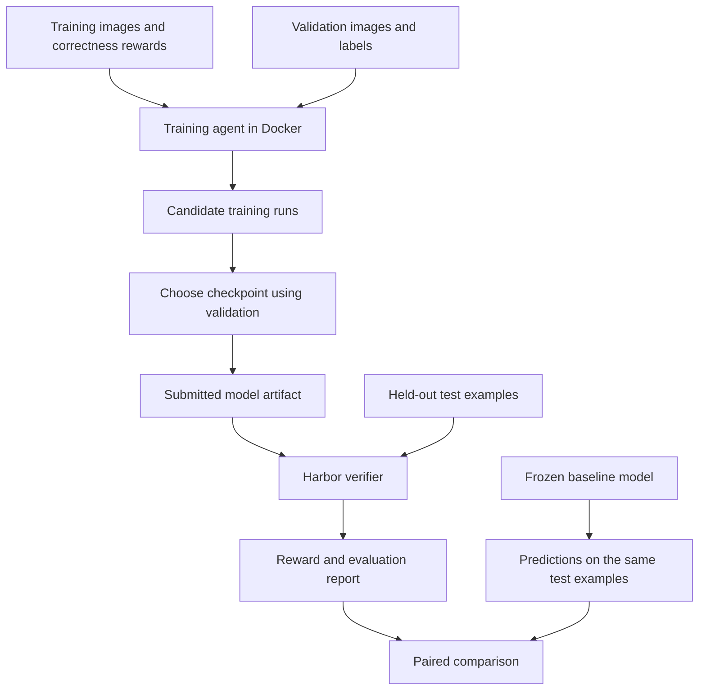

# Roboflow Labs onboarding lab

Build a small visual specialist, understand its reward loop, and learn how to test a claim that it outperforms a general model on a specific task. This independent project draws on public work; the [research notes](research.md) connect it to Roboflow Labs, Roboflow Agent, RF100-VL, and Humanity's Sixth Sense.

The first exercise takes roughly ten minutes after installing Python dependencies. It runs on a CPU with generated images and needs no API key. A separate GPU path fine-tunes an existing vision-language model on your own image questions.

| Path | What learns | Suitable data | Compute |
| --- | --- | --- | --- |
| CPU demonstration | A linear action policy using REINFORCE | Generated red-square/blue-circle spatial questions | Local CPU |
| Image counting specialist | A head over frozen ResNet18 features, with supervised warm start and REINFORCE | One fixed counting question over real images | CPU, Apple MPS, or CUDA |
| VLM training | LoRA adapter weights using GRPO | Image multiple-choice manifests | Linux and NVIDIA CUDA |
| Model evaluation | No weight updates | The same manifests with an endpoint, VLM, or saved predictions | Local or model provider |

## Understand the training environment



The **training agent** manages experiments and chooses a checkpoint. The **learned policy** answers image questions. Harbor runs the outer task and verifier, while the optimizer inside the container changes model weights. The built-in agent provides a reproducible training workflow; you can also use Harbor with a coding agent that writes its own solution.

## Run the CPU exercise

From the repository root, with [uv installed](https://docs.astral.sh/uv/getting-started/installation/):

```bash
uv sync --extra harbor --extra dev
source .venv/bin/activate
vision-rl demo --output runs/demo
```

Use a fresh output directory for each experiment. The demo generates independent training, validation, and test images, trains candidate policies, and produces artifacts under `runs/demo`. Start with `summary.json`, then inspect `comparison.json`, `specialist.json`, and `training/agent.json`. Candidate learning traces are in `training/candidate-*/history.jsonl`. An improvement demonstrates that the learning loop works. The initial policy is a local learning baseline; it is not a frontier-model benchmark result.

Each image contains a red square and a blue circle. The question asks whether the square is left, right, above, or below the circle. A fixed encoder measures their color centroids; a learned linear policy maps their relative position to action probabilities. The encoder is deliberately task-specific, and the CPU trainer rejects unrelated prompts and choices.

During REINFORCE training, the policy samples an answer, receives a correctness reward, and increases the probability of rewarded actions relative to its baseline. Validation selects which candidate to keep. Test performance is measured after selection. This teaches the mechanics of RL without a model download or GPU, but says nothing by itself about performance on natural photographs, HSS, or RF100-VL.

You can run the stages explicitly:

```bash
vision-rl generate --output data/spatial
vision-rl train \
  --train data/spatial/train.jsonl \
  --validation data/spatial/validation.jsonl \
  --output runs/spatial
vision-rl evaluate \
  --manifest data/spatial/test.jsonl \
  --checkpoint runs/spatial/policy.npz \
  --output runs/spatial-test.json
```

## Run it in Docker and Harbor

Start a Docker-compatible daemon and confirm `docker info` succeeds. Build the image and run the same exercise in its container:

```bash
docker build -t vision-rl:local .
docker compose run --rm demo
```

Compose writes artifacts to `runs/docker-demo` on the host and disables container networking for this offline exercise. That output directory must be empty when starting a new run. The equivalent direct Docker command, with a different output directory, is:

```bash
docker run --rm -v "$PWD/runs:/runs" vision-rl:local \
  vision-rl demo --output /runs/direct-demo
```

Run the packaged Harbor task to evaluate the training agent:

```bash
harbor run -p tasks/spatial-specialist \
  --agent vision_rl.harbor_agent:TrainingAgent
```

The agent receives training and validation data and submits `training/policy.npz` as an artifact. Harbor starts a **separate verifier container** that creates fresh test images, loads only the submitted numeric policy weights, and writes held-out accuracy as its reward. The verifier does not execute submitted Python code. Inspect the job under `jobs/` for the agent log, verifier evaluation, reward, and recorded holdout seed.

To understand the task contract, read `tasks/spatial-specialist/instruction.md`, `task.toml`, and `tests/verify.py`. The reference solution and empty-agent controls can be run with `--agent oracle` and `--agent nop`. A model-free empty submission should earn zero reward; the reference should produce a valid trained policy. This packaged task is the CPU onboarding task; the generated GPU task described below trains a VLM adapter on your dataset.

## Bring your own visual task

Store one JSON object per line. Image paths are relative to the manifest. This example describes a row; provide the actual image before loading it:

```json
{"id":"inspection-001","split":"train","image":"images/part-001.png","prompt":"How many screws are missing?","choices":["0","1","2","3"],"answer":"B","category":"missing-parts"}
```

Use `train`, `validation`, and `test` in separate manifests. IDs must be unique; answers are uppercase letters indexing 2–26 distinct choices. The loader verifies image content. Split checks detect duplicate IDs and identical decoded pixels across splits, including renamed images. They do not establish independence between near-duplicates, adjacent video frames, or photographs from the same scene: split those groups at collection time.

Write prompts that require looking at the image. Balance answer positions and include difficult negatives. Keep each label defensible from visible evidence. The optional VLM path handles these general image questions; the small CPU spatial policy does not.

## Connect a Roboflow dataset

Set `ROBOFLOW_API_KEY` in your environment or existing local `.env`. Use `.env.example` as the template if you do not have one. The CLI loads `.env` from the current directory, and `doctor` reports credential presence without printing secrets:

```bash
vision-rl doctor
vision-rl roboflow list
```

Choose a workspace/project slug and an existing dataset version. For an object-detection dataset, edit these example names to match your project:

```bash
vision-rl roboflow download \
  --workspace your-workspace --project your-project \
  --version 1 --format coco --output data/roboflow-export
vision-rl roboflow import-coco \
  --folder data/roboflow-export --output data/custom \
  --category screw --max-count 10
vision-rl audit \
  data/custom/train.jsonl data/custom/validation.jsonl data/custom/test.jsonl
```

The import produces counting questions from COCO annotations, preserving existing splits. Choose an actual category name, verify annotation completeness, and set a count range that covers every example. Crowd annotations and out-of-range counts are rejected. These are derived counting tasks; their scores are not object-detection AP or official RF100-VL results.

Omit `--category` to count all annotation classes, and use `--question` to describe the visible task clearly. For example, if an export's classes contain only black and white pawns:

```bash
vision-rl roboflow import-coco \
  --folder data/pawns-export --output data/pawns --max-count 25 \
  --question "How many chess pawns are visible in this image? Count both black and white pawns. Do not count other types of chess pieces."
```

The question changes the wording, not the labels. Ensure its meaning matches the annotations being counted; counting every annotated class would be wrong if the export also contains other chess pieces.

Audit spatial scope as well as category. For example, “all visible pawns” includes off-board pawns, while a board-only annotation set may omit them. The first project experiment found two confirmed mismatches of this kind and a third suspected omitted occluded pawn. Its reported scores are agreement with imported answers, not verified visual accuracy; see the [annotation audit](results.md). The evaluator's `accuracy` field measures exact agreement with the manifest's answers, so reliable visual conclusions require reliable labels.

For a single-label classification export with `train/<class>`, `valid/<class>`, and `test/<class>` folders, use `vision-rl roboflow import-classification --folder data/classification-export --output data/custom`. Import requires all three splits. Manifests reference the exported images, so preserve their relative locations when moving the dataset into a container.

These commands read project metadata and download a version; they do not start a hosted training job. The Roboflow credential and your GPU resources are separate. The imported manifests can be evaluated through an inference endpoint or used with the CUDA trainer below.

## Train a real-image counting specialist locally

The count-policy backend supports a concrete task such as counting one category of objects in photographs. It uses a frozen ImageNet ResNet18 encoder and learns a small head. Unlike the generated spatial exercise, it downloads pretrained vision weights and works with real images. Install its PyTorch dependencies in an isolated environment:

```bash
uv venv .venv-vision --python 3.12
uv pip install --python .venv-vision/bin/python -e . -r requirements-vision.txt
.venv-vision/bin/python -m vision_rl.vision_policy train \
  --train data/custom/train.jsonl \
  --validation data/custom/validation.jsonl \
  --output runs/counting --device auto
```

All rows must use the same counting question and choices `"0"`, `"1"`, … in order, with category `counting`. The COCO import above supplies that format. Use `--device cpu`, `mps`, or `cuda` to choose explicitly, or let `auto` select an available backend.

The training controller compares candidate heads and seeds using validation. Each head first learns with supervised cross-entropy, then receives sampled REINFORCE updates with an exact-count bonus, a distance-based reward, and a penalty for moving too far from its supervised policy. Report the supervised baseline separately: any gain over an untrained model cannot by itself be attributed to RL.

```bash
.venv-vision/bin/python -m vision_rl.vision_policy evaluate \
  --manifest data/custom/test.jsonl \
  --checkpoint runs/counting/policy.pt \
  --output runs/counting/specialist.json --device auto
.venv-vision/bin/python -m vision_rl.vision_policy evaluate \
  --manifest data/custom/test.jsonl \
  --checkpoint runs/counting/sft.pt \
  --output runs/counting/supervised.json --device auto
vision-rl compare runs/counting/specialist.json runs/counting/supervised.json \
  --output runs/counting/rl-vs-supervised.json
```

By default, checkpoints load their sibling `encoder.pt`; preserve the complete output directory. To use a separately reconstructed public encoder, supply `--trusted-encoder PATH`; its tensor fingerprint must match the checkpoint. Read `plan.json`, `training.json`, and `history.jsonl` to inspect the search and selection. This is a specialist for a fixed counting task, so its head does not interpret arbitrary new instructions. See [measured results](results.md) for the experiments actually run, and use a measured external-model baseline for any frontier comparison.

## Run real-image counting training in Harbor

Package the same three counting manifests into a task with separate training and verification data:

```bash
docker build -f Dockerfile.vision -t vision-rl:vision .
vision-rl make-count-task \
  --train data/custom/train.jsonl \
  --validation data/custom/validation.jsonl \
  --test data/custom/test.jsonl \
  --output runs/count-task --sft-epochs 160 --rl-steps 800
harbor run -p runs/count-task \
  --agent vision_rl.harbor_agent:CountTrainingAgent
```

The build installs CPU PyTorch and caches the frozen ResNet18 weights. After that, the training and verifier containers need no network access. The generated task requests two CPUs and 3 GiB of memory. `bundle.json` records the counts, split fingerprints, and training budget.

Only training and validation images enter the task's Docker build context. Test images are stored in `tests/data` and uploaded to a separate verifier after the agent finishes. The agent submits `training/policy.pt`, containing the learned head and feature normalization. The verifier uses restricted checkpoint loading, checks the submission schema, and pairs the head with its own fixed encoder at `/opt/encoder.pt`. It ignores submitted encoder replacements and Python code. Exact agreement with held-out manifest answers becomes the Harbor reward; the verifier does not independently audit those answers against the images.

Preserve the supervised checkpoint and experiment history alongside the submitted RL policy so the effect of the RL stage can be checked separately. A successful training run or high Harbor reward does not establish an RL benefit. The first experiment's [results](results.md) report raw imported-label agreement and the label-scope problems discovered during audit.

## Train a vision-language specialist

On a Linux machine with an NVIDIA CUDA GPU:

```bash
uv pip install -r requirements-vlm.txt
python -m vision_rl.vlm --preflight
python -m vision_rl.vlm \
  --train data/custom/train.jsonl \
  --validation data/custom/validation.jsonl \
  --output runs/vlm \
  --model Qwen/Qwen2.5-VL-3B-Instruct \
  --max-steps 100
```

The preflight checks local dependencies and CUDA without downloading a model. Training downloads the selected base model and updates LoRA adapters with GRPO. The training output includes `final_adapter`, periodic checkpoints, and `training_metadata.json`. Choose a model permitted by its license and a batch/image configuration that fits your GPU. Run this single-GPU implementation directly with Python; it does not support a multi-process `accelerate` launch. CPU-only and macOS systems should use the first exercise or a remote CUDA machine for this path.

The optional dependency stack has been checked against its published interfaces and unit-tested without a GPU. A full CUDA training run has not been validated on the development Mac; run a short smoke experiment on your target GPU before committing to a larger run.

Resume a compatible interrupted run with the same data and configuration:

```bash
python -m vision_rl.vlm \
  --train data/custom/train.jsonl \
  --validation data/custom/validation.jsonl \
  --output runs/vlm \
  --model Qwen/Qwen2.5-VL-3B-Instruct \
  --max-steps 100 \
  --resume-from-checkpoint runs/vlm/checkpoint-25
```

Replace the checkpoint path with one actually saved by your run. A training completion message is not evidence of improved generalization; evaluate the frozen adapter against a baseline.

The direct VLM trainer records validation metrics and saves the final training state in `final_adapter`; it does not automatically sweep model configurations or select the best checkpoint. Use validation to make those choices before opening the test results. Evaluate a frozen adapter locally on the CUDA machine:

```bash
vision-rl evaluate \
  --manifest data/custom/test.jsonl \
  --vlm-model Qwen/Qwen2.5-VL-3B-Instruct \
  --adapter runs/vlm/final_adapter \
  --max-tokens 128 \
  --output runs/specialist.json
```

Omit `--adapter` to measure the base VLM. That gives an adaptation baseline; a claim about beating a frontier model also needs measured predictions from that named model.

To use the same trainer in a GPU container, first configure [NVIDIA Container Toolkit](https://docs.nvidia.com/datacenter/cloud-native/container-toolkit/latest/install-guide.html) on your Linux GPU host and verify Docker can access the GPU, then:

```bash
docker build -f Dockerfile.gpu -t vision-rl:gpu .
docker run --rm --gpus all \
  -v "$PWD/data:/data:ro" -v "$PWD/runs:/runs" \
  -v vision-rl-model-cache:/cache/huggingface \
  vision-rl:gpu python -m vision_rl.vlm \
  --train /data/custom/train.jsonl \
  --validation /data/custom/validation.jsonl \
  --output /runs/vlm-docker \
  --model Qwen/Qwen2.5-VL-3B-Instruct --max-steps 100
```

Mount the complete data directory, including the image exports that the manifests reference. This GPU image is separate from the CPU image used in the ten-minute exercise.

## Package your VLM training as a Harbor task

The task builder copies your images and manifests into a portable task bundle. It can run locally without CUDA and checks all three splits for duplicate IDs or image pixels:

```bash
vision-rl make-vlm-task \
  --train data/custom/train.jsonl \
  --validation data/custom/validation.jsonl \
  --test data/custom/test.jsonl \
  --output runs/custom-task \
  --model Qwen/Qwen2.5-VL-3B-Instruct \
  --max-steps 100 --max-tokens 128
```

On the Linux NVIDIA host, build the GPU image as above and run:

```bash
harbor run -p runs/custom-task \
  --agent vision_rl.harbor_agent:VLMTrainingAgent
```

The training image contains only train and validation data. Test images remain under the bundle's `tests/` directory for upload to Harbor's separate verifier. The agent runs the bounded GRPO training workflow and submits `training/final_adapter/adapter_config.json` and `adapter_model.safetensors`. The verifier loads the allowed adapter artifacts with the configured base model and fixed inference code, evaluates test answers, and returns accuracy as reward. Inspect `bundle.json` for the recorded split counts and fingerprints.

The generated task requests one GPU and allows network access to download model weights. It sets a one-hour agent timeout and a fifteen-minute verifier timeout; inspect the generated `task.toml` and adjust resources for your model and dataset. No Hugging Face credential is forwarded by default. The example uses a public model; a gated model requires explicit credentials for both training and verification. Keep the bundle private if its copied data is private. The full GPU Harbor run still needs validation on your target CUDA host.

## Evaluate a baseline and compare results

With a Roboflow account, the native Gemini adapter can evaluate an available model using `ROBOFLOW_API_KEY`:

```bash
python -m vision_rl.roboflow_inference \
  --manifest data/custom/test.jsonl \
  --output runs/argon-baseline \
  --model gemini-4-argon --thinking-level low \
  --max-tokens 4096 --max-requests 100
vision-rl compare runs/counting/specialist.json runs/argon-baseline/evaluation.json \
  --output runs/counting/rl-vs-argon.json
```

This uses Roboflow's native Gemini proxy, the same route as its [Gemini Workflow block](https://github.com/roboflow/inference/blob/main/workflows/roboflow_workflows/core_steps/models/foundation/google_gemini/v6.py). Requests consume Roboflow credits and do not require a separate Google key. The adapter uses provider-default temperature and the chosen thinking level, so this is not a deterministic-temperature-zero run. It records predictions, usage, latency, and the provider's model version in `evaluation.json`, `predictions.jsonl`, and `raw-responses.jsonl`. Choose a new output directory; each item gets one request with no automatic retry. Use validation first when discovering a task, then run the frozen test comparison.

The endpoint backend accepts a base URL whose server implements multimodal `/chat/completions`, including image data URLs. Set `MODEL_ENDPOINT` to that base URL and `MODEL_ID` to the actual model ID. If authentication is needed, set `MODEL_API_KEY` in your environment or local `.env`; never put a key in a command argument or tracked file.

```bash
vision-rl evaluate \
  --manifest data/custom/validation.jsonl \
  --endpoint "$MODEL_ENDPOINT" \
  --model "$MODEL_ID" \
  --max-requests 100 \
  --output runs/baseline-validation.json
```

The explicit request budget must cover the manifest. This generic endpoint path uses temperature zero and one attempt per example, with no automatic retries. Both candidates receive the same image and answer-format instruction. Unsupported provider parameters or failed requests appear as errors and score as failures; resolve those before interpreting a model comparison. Evaluation does not send the reference answer.

You can also score predictions made by another inference system. Save JSONL rows with unique IDs and response text:

```json
{"id":"inspection-test-001","response":"<answer>B</answer>"}
```

```bash
vision-rl evaluate \
  --manifest data/custom/test.jsonl \
  --predictions runs/baseline-predictions.jsonl \
  --model "$MODEL_ID" \
  --output runs/baseline.json
```

Valid answers are a single uppercase choice letter or `<answer>LETTER</answer>`. Extra prose and malformed answers score zero under this task's strict protocol. Missing predictions also count as failures; unknown IDs are rejected. Imported predictions carry user-supplied provenance, so save the original model/settings log alongside them.

After producing `runs/specialist.json` and `runs/baseline.json` on the same test manifest:

```bash
vision-rl compare runs/specialist.json runs/baseline.json \
  --output runs/comparison.json
```

Comparison requires matching dataset fingerprints, protocol, split labels, and example IDs. It reports the accuracy difference, paired bootstrap interval, wins/ties, and evaluation errors. All accuracy values and interval bounds are proportions: a difference of `0.05` means five percentage points. The tool verifies matched records; it cannot verify that a remote provider's model name is truthful or that a human never inspected the test labels.

Inspect disagreements against the actual images before interpreting a score:

```bash
vision-rl review --manifest data/custom/test.jsonl \
  --reports runs/specialist.json runs/baseline.json \
  --output runs/disagreements.html
```

Open that self-contained HTML file locally; it embeds dataset images and should stay with private experiment artifacts. Comparisons default to an `unreviewed` annotation status. To attach an audit, pass `--label-audit path/to/audit.json` to `compare`. The JSON must contain the matching `dataset_fingerprint` and a `status` of `unreviewed`, `reviewed`, or `issues_found`; use `reviewed` only after completing the annotation review. `issues_found` blocks a positive capability interpretation even when the raw label-agreement difference is positive. This records a declared review status, not an automated certification of the dataset.

## Find and measure a frontier capability gap

1. **Discover on validation.** Query real baseline models on an independent validation set. Examine errors by category, such as fine object counting or a particular inspection defect. Do not use the final test answers to choose the task, prompt, reward, or model.
2. **Freeze the experiment.** Record model IDs, prompt template, inference settings, dataset revision, training budget, and the metric. Group related scenes into disjoint splits. Establish a final test set before the training agent starts optimizing.
3. **Train and select.** Reward correctness on training examples. Compare candidate configurations on validation. Repeated validation selection can overfit too; limit the search budget or reserve a second confirmation set.
4. **Evaluate on matched examples.** Run the specialist and baseline on identical untouched test inputs. Save predictions and failed requests. Use the paired comparison tool so the uncertainty is measured on the difference, not on unrelated averages.
5. **Report the scope.** Include the named task, model versions, sample count, accuracy difference and interval, category results, and inference budget. A positive point estimate with an interval spanning zero is inconclusive. Neither a win against a random policy nor a published score from another protocol establishes a win against a frontier model.

If examples share videos, patients, sites, or scenes, resample those groups when assessing uncertainty; per-image bootstrap intervals can be too optimistic. For a public benchmark, preserve the official scoring protocol. HSS needs video and rubric grading; RF100-VL needs detector outputs and AP. See the [integration requirements](research.md#requirements-for-a-faithful-hss-adapter) before using those benchmark names in a result.

## Learning checkpoints

- Explain which parameters learned and which visual features were fixed in the CPU exercise.
- Trace one sampled answer through reward, policy update, validation selection, and final verification.
- Replace the generated task with a small permitted dataset and explain why a VLM backend is necessary.
- Produce a comparison report against an actual named baseline, including uncertainty and failures.
- Explain what additional data and evaluator work would be required for a faithful HSS or RF100-VL result.
