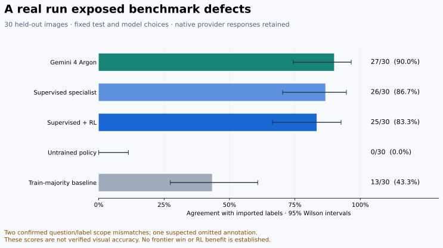

# Measured results and what the audit changed

This project was exercised on real Roboflow images, a live Gemini 4 Argon endpoint, and Docker/Harbor. **It did not establish a frontier-model win. More importantly, dogfooding exposed a question/annotation mismatch that would have made a performance claim misleading.**

The numbers below are agreement with imported labels, **not independently verified visual accuracy**. Predictions, labels, native API responses, training history, model checkpoints, and hashes are retained in the [evidence bundle](../reports/2026-10-16-pawn-counting/). No examples were removed or rescored after observing results.



## The actual experiment

The task asked: “How many chess pawns are visible in this image? Count both black and white pawns. Do not count other types of chess pieces.” Its 26 answer choices represented counts 0–25. A versioned COCO export supplied 201 training images, 58 validation images, and 30 test images. The images are real photographs of chess pieces and a board.

The specialist used a frozen ImageNet ResNet18 image encoder and a learned counting head. Four candidates were declared before evaluation: linear or 128-unit heads, each with seed 7 or 19. Each received 160 epochs of supervised warmup followed by 800 REINFORCE updates. The reward was exact-answer correctness minus normalized absolute count error, with eight sampled actions per observation, a leave-one-out baseline, entropy regularization, and a KL penalty to the supervised policy.

Validation selected the linear, seed-7 candidate: its 26,650 trainable head parameters achieved 51/58 label matches before RL and 52/58 after RL. The final run took 9.57 seconds on an Apple M5 Pro using cached pretrained weights; the earlier run before the final artifact format took 24.68 seconds. The [training plan](../reports/2026-10-16-pawn-counting/training-plan.json) and [frozen evaluation plan](../reports/2026-10-16-pawn-counting/heldout-evaluation-plan.json) record the settings and checkpoint hashes.

| Frozen model or control | Imported-label agreement | Count MAE against labels |
| --- | ---: | ---: |
| Gemini 4 Argon, low thinking | 27/30 — 90.00% | 0.167 |
| Supervised specialist | 26/30 — 86.67% | 0.200 |
| Supervised + RL specialist | 25/30 — 83.33% | 0.200 |
| Training-set majority count | 13/30 — 43.33% | 5.367 |
| Untrained head, fixed initialization | 0/30 — 0.00% | 11.100 |

The untrained result is one fixed initialization, not an estimate of uniform random performance. The stronger control is the majority count chosen from training labels.

The RL specialist matched two examples that Argon did not, while Argon matched four that the RL specialist did not. The paired item-bootstrap difference was −6.67 percentage points, with a conventional 95% interval of [−23.33, +10.00]. RL versus supervised was −3.33 points, interval [−10.00, 0.00]. These descriptive intervals assume independent items; shared visual context and annotation defects limit their interpretation. Neither supports an RL benefit or a frontier win.

## Why these are label-agreement scores

Error inspection found that the question and source annotation policy did not consistently describe the same objects:

- One image has seven annotated board pawns plus three visible off-board pawns. Argon answered ten, consistent with the question.
- Another has five annotated board pawns plus one visible off-board pawn. Argon answered six, again consistent with the question.
- A third appears to contain a partially occluded, unannotated black pawn. This is a suspected omission requiring independent human confirmation.

The [annotation audit](../reports/2026-10-16-pawn-counting/annotation-audit.json) records IDs, approximate coordinates, and source boxes. This audit examined the disagreements and four validation spot checks; it is not a comprehensive human relabeling. No corrected “100%” score is claimed.

The [split audit](../reports/2026-10-16-pawn-counting/data-audit.json) found no exact file, decoded-pixel, source-ID, or source-filename overlap. Every imported answer matched its COCO annotation count. However, all 30 test images had a visually similar training image under the coarse pHash threshold; 13 had the same pHash. Inspection showed that identical hashes can hide different chess pieces against the same board. These are similarity candidates, not proof of duplicate leakage. Independent capture/session generalization and pretrained-data contamination were not established.

We also checked another existing dataset version for fresh evaluation data. Its 259 images were exactly the same 201 training and 58 validation images, with the same normalized annotations and no test split. The [additional-data audit](../reports/2026-10-16-pawn-counting/additional-data-audit.json) rules it out as new evidence.

## Live inference and container evidence

The Roboflow Gemini proxy returned the native provider model version `gemini-4-argon` on the 30 test requests. Settings were fixed at low thinking, maximum 4,096 output tokens, provider-default temperature, and one attempt per image. There were zero transport errors, invalid answers, or retries. Two separate validation smoke calls preceded this test.

The provider reported **39,120 input tokens and 330 completion tokens** for the test. Reasoning-token usage was not separately present in the native responses. Summed HTTP latency was 152.98 seconds, mean 5.099 seconds, median 4.078 seconds. Billed credits were not returned; no measured monetary cost is asserted. [Native responses](../reports/2026-10-16-pawn-counting/argon-native-responses.jsonl) and [usage summary](../reports/2026-10-16-pawn-counting/argon-usage.json) preserve the evidence.

The local RL test batch took 3.12 seconds including its cold inference setup; the subsequent supervised batch took 0.40 seconds. These differ in warmup and batching from the sequential remote requests and are **not a controlled speedup benchmark**.

We also reloaded the exact compact checkpoints distributed in this repository through the public evaluation CLI. Both reproduced every published prediction: **60/60 predictions matched**, including their aggregate scores, dataset fingerprints, and checkpoint hashes. The [checkpoint replay](../reports/2026-10-16-pawn-counting/checkpoint-replay.json) records that check.

Real-data Harbor dogfooding rebuilt a task container, trained the specialist with network access disabled, transferred its numeric policy, and graded it in a fresh container with the verifier's immutable pretrained encoder. It reproduced **25/30 label matches**, with no trial exception, in approximately 93 seconds end to end. The [trial result](../reports/2026-10-16-pawn-counting/harbor-trial.json) and [independent evaluation](../reports/2026-10-16-pawn-counting/harbor-evaluation.json) are retained. This replay validates execution; it is not a new statistical test set.

The synthetic onboarding task also ran in Docker and Harbor: the trained reference and custom training agent each earned 1.0 on fresh generated holdouts; the empty agent earned 0.0. The [control trial records](../reports/2026-10-16-pawn-counting/harbor-control-trials.json) retain those outcomes. Those synthetic results are plumbing evidence only. The optional CUDA VLM GRPO path has contract tests and source-verified API wiring, but was not GPU-executed on this Mac.

## Reproduce and inspect

Dataset images and credentials remain local. Someone without access to this dataset can reproduce the harness with their own export and can inspect every published prediction, model weight, and API response here. The code supports Python 3.12; follow the [onboarding commands](onboarding.md) to install the dependencies.

On the Mac used for these runs, Docker uses an isolated Colima profile named `vision-harbor`. To repeat container commands on that machine, start the profile if needed and select its socket for the current shell:

```bash
colima start --profile vision-harbor
export DOCKER_HOST="unix://$HOME/.colima/vision-harbor/docker.sock"
uv run vision-rl doctor
```

This leaves the machine's global Docker context unchanged. Other hosts can use their existing running Docker daemon.

```bash
# Recreate the canonical counting question when importing an accessible export.
vision-rl roboflow import-coco --folder data/source --output data/pawns \
  --max-count 25 \
  --question 'How many chess pawns are visible in this image? Count both black and white pawns. Do not count other types of chess pieces.'

# Reproduce this recorded experiment, including its known annotation limitations.
.venv-vision/bin/python -m vision_rl.vision_policy train \
  --train data/pawns/train.jsonl --validation data/pawns/validation.jsonl \
  --output runs/reproduction --device auto

# Inspect images and all model disagreements locally, before making capability claims.
vision-rl review --manifest data/pawns/test.jsonl \
  --reports reports/2026-10-16-pawn-counting/rl-evaluation.json \
    reports/2026-10-16-pawn-counting/argon-evaluation.json \
  --output runs/disagreements.html
```

The review command checks the dataset fingerprint and embeds image evidence in a self-contained local HTML artifact. It intentionally does not publish private images. The bundled compact policy checkpoints can be reused by reconstructing the public frozen encoder:

```bash
.venv-vision/bin/python scripts/prepare_encoder.py --output runs/public-encoder.pt
.venv-vision/bin/python -m vision_rl.vision_policy evaluate \
  --manifest data/pawns/test.jsonl \
  --checkpoint reports/2026-10-16-pawn-counting/checkpoints/rl.pt \
  --trusted-encoder runs/public-encoder.pt \
  --output runs/published-checkpoint.json --device auto
```

For the next valid capability experiment, establish a consistent object scope, independently review annotations, collect new scene/session groups, and seal a fresh test split before further training or model selection. Rephrasing this already inspected test and retesting it would be exploratory evidence, not a fresh confirmation.
