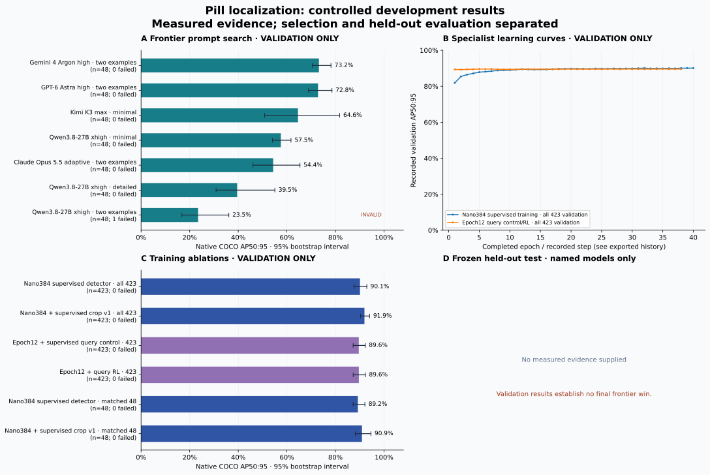

# Pill localization: controlled development results

The strongest completed 384-pixel detector plus supervised crop refinement reaches 91.93% AP50:95 on all 423 validation images, up from 90.09% for the detector alone. AP at IoU 0.95 rises from 33.09% to 42.95%. This improvement is supervised; the project has not demonstrated the requested substantial RL advantage or a final-test frontier win.

The controlled query-RL result is 89.6289% AP versus 89.6002% for its supervised control, only +0.0287 percentage points. These use an earlier detector and the same frozen top-128 proposal cache. Two direct-policy pilots also fail the predeclared +2-point sampled-headroom gate. The direct trainer remains unfinished; a finite gradient probe is not a completed RL training result.

All frontier discovery rows below use the same 48 validation images. Correcting the documented bbox_2d alias changes Qwen's prompt ranking: minimal 57.52%, detailed 39.54%, two examples 23.46% with one remaining invalid response. The minimal prompt is Qwen's strongest measured variant, not the strongest overall frontier. Gemini 4 Argon high with two examples remains at 73.19%; GPT-6 Astra high at 72.82%. All 25 recorded runs were rescored consistently without new API calls.

The 200-image native test remains sealed. The separate 375-image Gemini confirmation stopped with 185 failed or missing responses after credit exhaustion and is invalid for primary comparisons. The live 512-pixel training run and local 8-bit Qwen download have no completed result in this snapshot. Development is pivoting toward the separately named wheat domain-accuracy protocol without using pills test outcomes to choose the task.

The pipeline bridge replay produced byte-identical predictions and resumed with zero additional commands. Its native final-freeze check rejected the two-image smoke before test access. Earlier Harbor runs completed both CPU training trials without errors and changed 462 detector tensors under a nonzero learning rate; the current typed crop verifier also ran on three validation-derived images. These establish working integration, not the benchmark objective.

Only measured persisted evidence appears below. Validation data guided training and prompt selection; it does not establish a held-out frontier win.

**Frozen test gate: not evaluated.** Requires specialist AP ≥ 80%, advantage ≥ 20 percentage points, paired 95% CI lower bound ≥ 10 points, and zero transport/parse failures against every named baseline.

Native metric: COCO AP50:95, 101 recall points, maxDets=500. Intervals are percentile bootstrap intervals conditional on this sample; capture groups are used where supplied. Neither an interval nor a passing gate establishes annotation quality or unseen-session generalization.

## Validation — selection only

| Model / configuration | Images | AP50:95 | 95% CI | Failures | Resampling |
| --- | --- | --- | --- | --- | --- |
| Gemini 4 Argon high · two examples | 48 | 73.19% | 70.5%–78.2% | 0 | capture-group bootstrap |
| GPT-6 Astra high · two examples | 48 | 72.82% | 68.9%–78.6% | 0 | capture-group bootstrap |
| Kimi K3 max · minimal | 48 | 64.57% | 50.9%–81.7% | 0 | capture-group bootstrap |
| Qwen3.8-27B xhigh · minimal | 48 | 57.52% | 54.1%–61.7% | 0 | capture-group bootstrap |
| Claude Opus 5.5 adaptive · two examples | 48 | 54.35% | 46.0%–65.4% | 0 | capture-group bootstrap |
| Qwen3.8-27B xhigh · detailed | 48 | 39.54% | 30.9%–55.1% | 0 | capture-group bootstrap |
| Qwen3.8-27B xhigh · two examples | 48 | 23.46% | 16.8%–36.1% | 1 | capture-group bootstrap |
| Nano384 supervised detector · all 423 | 423 | 90.09% | 87.6%–92.9% | 0 | capture-group bootstrap |
| Nano384 + supervised crop v1 · all 423 | 423 | 91.93% | 90.3%–94.0% | 0 | capture-group bootstrap |
| Epoch12 + supervised query control · 423 | 423 | 89.60% | 87.3%–92.3% | 0 | capture-group bootstrap |
| Epoch12 + query RL · 423 | 423 | 89.63% | 87.3%–92.3% | 0 | capture-group bootstrap |
| Nano384 supervised detector · matched 48 | 48 | 89.21% | 87.3%–92.1% | 0 | capture-group bootstrap |
| Nano384 + supervised crop v1 · matched 48 | 48 | 90.91% | 88.2%–94.6% | 0 | capture-group bootstrap |

Rows with different dataset fingerprints or image counts are not paired comparisons. Failed requests remain in the denominator and invalidate a performance-win claim.

## Frozen held-out test

No measured reports supplied.

## Paired differences

| Phase | Specialist / baseline | AP difference | 95% CI | Valid evaluation | Margin met |
| --- | --- | --- | --- | --- | --- |
| validation | crop-v1-full / final384-full | +1.84 pp | [+0.70, +2.85] pp | True | False |
| validation | query-rl-full / query-warmup-full | +0.03 pp | [-0.08, +0.13] pp | True | False |
| validation | crop-v1-48 / argon-structured-fewshot-48 | +17.72 pp | [+13.61, +21.10] pp | True | False |
| validation | crop-v1-48 / astra-fewshot-48 | +18.09 pp | [+13.17, +23.35] pp | True | False |
| validation | crop-v1-48 / kimi-minimal-48 | +26.34 pp | [+10.66, +38.15] pp | True | True |
| validation | crop-v1-48 / qwen-minimal-48 | +33.39 pp | [+27.45, +38.98] pp | True | True |
| validation | crop-v1-48 / opus-fewshot-48 | +36.56 pp | [+26.81, +43.27] pp | True | True |

## Runtime and resource measurements

**Crop v1 refinement over existing proposals** — 423 validation images; CPU, two threads; excludes detector proposal generation.

| Measurement | Recorded value |
| --- | --- |
| Wall seconds | 6.315207874999032 |
| Milliseconds per image | 14.929569444442157 |
| Refined proposals | 1976 |
| AP95 before | 0.33090677951981695 |
| AP95 after | 0.4294574709646068 |

**Direct-policy training-only diagnostics** — 128 training images; best-of-64 samples per image, not learned-policy or validation scores. Reported pilot seconds exclude initial dataset/model setup.

| Measurement | Recorded value |
| --- | --- |
| Mean per-image training AP | 0.9708225931123703 |
| Dense pilot seconds | 18.196966792005696 |
| Dense sampled gain | 0.005535968142632655 |
| Dense counterfactual output SNR | 1.0443788369357272 |
| Dense leave-one-out output SNR | 0.3296648871307469 |
| Sparse pilot seconds | 18.0978065829986 |
| Sparse sampled gain | 0.015344203476969208 |
| Required sampled gain | 0.02 |
| Dense gate passed | False |
| Sparse gate passed | False |

Latency scopes, hardware and warmup conditions must match before computing speedups. Provider-reported tokens are usage evidence; billed money or credits are unknown unless a billing source supplies them.

## Scope and limitations

- Validation guided detector, refinement, and prompt selection. These descriptive intervals do not correct for that selection and do not establish a final win.
- Capture-hour groups cross native splits. All unknown capture images are pooled into one conservative cluster. This benchmark does not establish unseen-session generalization.
- The 128-image pilot mean training-image AP (97.08%) uses per-image averaging and training data; it is not comparable to global validation COCO AP (90.09%).
- Crop runtime is 14.93 ms per image on CPU for refinement over existing proposals, not full detector-plus-crop latency. Provider latency totals sum calls and are not concurrent batch wall time.
- Pipeline replay and Harbor smoke are integration evidence on two or three validation-derived images, not benchmark scores. The typed crop smoke did not perform a full Docker rebuild.
- Published native journals retain model responses but sanitize local paths and credential fields; the immutable rescore manifest records original source hashes. No model weights or giant COCO matching caches are embedded.
- Broad suite evidence is 546 passed/21 skipped/1 deselected in core and 715 passed/6 skipped/5 deselected in detection. Reporter compression changes were separately checked with its 11 tests after those suite runs.
- Pilot wall times start after dataset/model setup. Signal-to-noise values describe gradients at actor outputs on eight images, not full parameter-gradient variance.

## Reproduction evidence

Compact evaluation JSON preserves model identity, source fingerprints and per-image counts. Prediction CSV files (gzip-compressed when configured) preserve every scored box and confidence. Matching caches are omitted from this bundle; Recompute them from these predictions and the source COCO annotations using `evaluate_coco`. `sources.json` hashes original inputs; `checksums.json` hashes published files.

Machine-readable exports: [metrics.csv](metrics.csv), [summary.json](summary.json), [histories.json](histories.json), [sources.json](sources.json).
