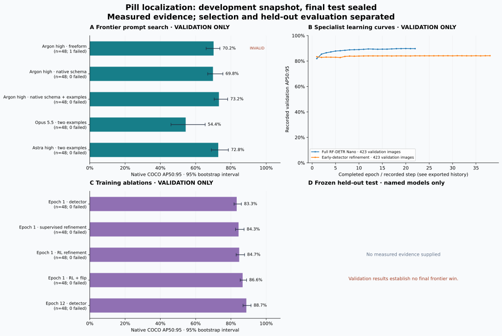

# Pill localization: development snapshot, final test sealed

Only measured persisted evidence appears below. Validation data guided training and prompt selection; it does not establish a held-out frontier win.

**Frozen test gate: not evaluated.** Requires specialist AP ≥ 80%, advantage ≥ 20 percentage points, paired 95% CI lower bound ≥ 10 points, and zero transport/parse failures against every named baseline.

Native metric: COCO AP50:95, 101 recall points, maxDets=500. Intervals are percentile bootstrap intervals conditional on this sample; capture groups are used where supplied. Neither an interval nor a passing gate establishes annotation quality or unseen-session generalization.

## Validation — selection only

| Model / configuration | Images | AP50:95 | 95% CI | Failures | Resampling |
| --- | --- | --- | --- | --- | --- |
| Argon high · freeform | 48 | 70.17% | 66.0%–73.8% | 1 | capture-group bootstrap |
| Argon high · native schema | 48 | 69.82% | 66.9%–75.4% | 0 | capture-group bootstrap |
| Argon high · native schema + examples | 48 | 73.19% | 70.5%–78.2% | 0 | capture-group bootstrap |
| Opus 5.5 · two examples | 48 | 54.35% | 46.0%–65.4% | 0 | capture-group bootstrap |
| Astra high · two examples | 48 | 72.82% | 68.9%–78.6% | 0 | capture-group bootstrap |
| Epoch 1 · detector | 48 | 83.27% | 81.8%–85.9% | 0 | capture-group bootstrap |
| Epoch 1 · supervised refinement | 48 | 84.32% | 82.6%–87.4% | 0 | capture-group bootstrap |
| Epoch 1 · RL refinement | 48 | 84.69% | 83.0%–87.7% | 0 | capture-group bootstrap |
| Epoch 1 · RL + flip | 48 | 86.63% | 85.3%–88.9% | 0 | capture-group bootstrap |
| Epoch 12 · detector | 48 | 88.74% | 86.9%–91.4% | 0 | capture-group bootstrap |

Rows with different dataset fingerprints or image counts are not paired comparisons. Failed requests remain in the denominator and invalidate a performance-win claim.

## Frozen held-out test

No measured reports supplied.

## Paired differences

| Phase | Specialist / baseline | AP difference | 95% CI | Valid evaluation | Margin met |
| --- | --- | --- | --- | --- | --- |
| validation | epoch12-detector / argon-rich-retry2-48 | +18.57 pp | [+14.30, +24.41] pp | False | False |
| validation | epoch12-detector / argon-structured-rich-48 | +18.92 pp | [+13.73, +22.72] pp | True | False |
| validation | epoch12-detector / opus-fewshot-48 | +34.39 pp | [+24.39, +41.56] pp | True | True |
| validation | epoch12-detector / astra-fewshot-48 | +15.93 pp | [+10.43, +21.14] pp | True | False |
| validation | epoch12-detector / argon-structured-fewshot-48 | +15.55 pp | [+10.84, +19.01] pp | True | False |

## Scope and limitations

- All scored rows use the same fixed 48 validation discovery images; these guided selection and are not final test evidence.
- Learning curves use all 423 validation images. The ongoing detector and architectural experiments are incomplete in this snapshot.
- Native splits share capture-hour groups; this does not establish unseen-session generalization. Unknown capture images are conservatively grouped together here.
- Visual review found no confirmed scope or label defect in 18 images with 92 boxes. This was an AI-assisted spot-check, not comprehensive independent human annotation.
- Pill presence is already strong for frontier models; the measured gap concerns precise bounding-box localization.

## Reproduction evidence

Compact evaluation JSON preserves model identity, source fingerprints and per-image counts. Prediction CSV files preserve every scored box and confidence. Matching caches are omitted from this bundle; Recompute them from these predictions and the source COCO annotations using `evaluate_coco`. `sources.json` hashes original inputs; `checksums.json` hashes published files.

Machine-readable exports: [metrics.csv](metrics.csv), [summary.json](summary.json), [histories.json](histories.json), [sources.json](sources.json).
