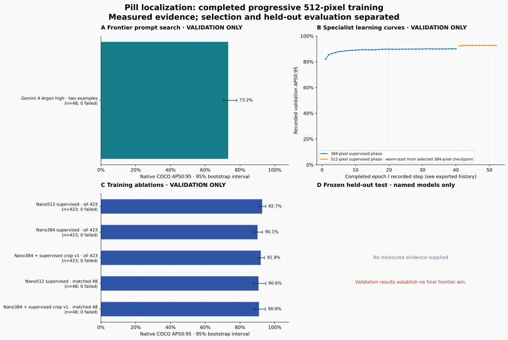

# Pill localization: completed progressive 512-pixel training

The completed supervised 384→512-pixel RF-DETR Nano run reaches 92.75% AP50:95 on all 423 validation images. This is +2.66 percentage points over the 384-pixel detector and +0.82 points over its supervised crop-refinement pipeline. It is a supervised improvement; the requested substantial RL advantage remains unproven.

On the same 48 discovery images, Nano512 scores 90.64% versus 73.19% for the strongest measured Gemini configuration (Argon high, structured output, two examples). The +17.45-point advantage misses the required 20 points. Nano512 also trails the 384-pixel crop pipeline by 0.27 points on these 48 images; that negative comparison is retained below.

Training completed all 12 additional epochs and 1,092 optimizer updates. Epoch 4 was selected using EMA AP on all 423 validation images. The phase warm-started from the selected 384-pixel weights with fresh AdamW state and official positional-grid interpolation, using learning rates 1e-5, batch 4 × accumulation 4, and seed 42. All 466 exported tensors match the native checkpoint and trusted 512-pixel reload exactly.

The measured 512-pixel fit took 36.60 minutes, excluding model setup. Recorded 384+512 fit time totals 2.34 hours and includes the recorded interrupted 384-pixel attempt. Maximum sampled MPS driver memory was 7.54 GiB; periodic telemetry does not establish a continuous peak.

The 200-image pills test remains sealed. No new hosted calls, model inference, or training were performed to build this report. [The earlier frozen report](../2026-10-16-controlled-rl-development/README.md) retains the 25 original frontier journals, parser amendment, small query-RL gain, failed direct-policy pilots, and Docker/Harbor integration evidence. Those files are linked rather than recopied here.

Only measured persisted evidence appears below. Validation data guided training and prompt selection; it does not establish a held-out frontier win.

**Frozen test gate: not evaluated.** Requires specialist AP ≥ 80%, advantage ≥ 20 percentage points, paired 95% CI lower bound ≥ 10 points, and zero transport/parse failures against every named baseline.

Native metric: COCO AP50:95, 101 recall points, maxDets=500. Intervals are percentile bootstrap intervals conditional on this sample; capture groups are used where supplied. Neither an interval nor a passing gate establishes annotation quality or unseen-session generalization.

## Validation — selection only

| Model / configuration | Images | AP50:95 | 95% CI | Failures | Resampling |
| --- | --- | --- | --- | --- | --- |
| Gemini 4 Argon high · two examples | 48 | 73.19% | 70.5%–78.2% | 0 | capture-group bootstrap |
| Nano512 supervised · all 423 | 423 | 92.75% | 91.0%–94.8% | 0 | capture-group bootstrap |
| Nano384 supervised · all 423 | 423 | 90.09% | 87.6%–92.9% | 0 | capture-group bootstrap |
| Nano384 + supervised crop v1 · all 423 | 423 | 91.93% | 90.3%–94.0% | 0 | capture-group bootstrap |
| Nano512 supervised · matched 48 | 48 | 90.64% | 87.5%–94.8% | 0 | capture-group bootstrap |
| Nano384 + supervised crop v1 · matched 48 | 48 | 90.91% | 88.2%–94.6% | 0 | capture-group bootstrap |

Rows with different dataset fingerprints or image counts are not paired comparisons. Failed requests remain in the denominator and invalidate a performance-win claim.

## Frozen held-out test

No measured reports supplied.

## Paired differences

| Phase | Specialist / baseline | AP difference | 95% CI | Valid evaluation | Margin met |
| --- | --- | --- | --- | --- | --- |
| validation | nano512-full / nano384-full | +2.66 pp | [+1.42, +3.48] pp | True | False |
| validation | nano512-full / crop-v1-full | +0.82 pp | [+0.27, +1.25] pp | True | False |
| validation | nano512-48 / argon-structured-fewshot-48 | +17.45 pp | [+13.56, +21.60] pp | True | False |
| validation | nano512-48 / crop-v1-48 | -0.27 pp | [-1.27, +1.35] pp | True | False |

## Runtime and resource measurements

**Completed progressive supervised training** — Recorded fit invocation wall time, including training validation/checkpoint overhead; excludes model setup, preflights, reporting, and independent extraction. Base total includes its recorded interrupted attempt. Maximum observed among 82 periodic telemetry samples; not a continuous allocator peak and not a sum of RSS plus shared MPS memory.

| Measurement | Recorded value |
| --- | --- |
| 512-pixel fit seconds | 2196.2285587500082 |
| 384-pixel recorded fit seconds | 6228.095138624005 |
| Combined recorded fit seconds | 8424.323697374013 |
| 512 epochs completed | 12 |
| 512 selected epoch | 4 |
| Optimizer steps | 1092 |
| Maximum sampled MPS driver GiB | 7.543304443359375 |
| Maximum sampled process RSS GiB | 2.769439697265625 |
| Model parameters | 30319108 |

**Training intervals and validation extraction** — Median elapsed/20 optimizer-step difference between adjacent train_progress records in the same epoch; excludes validation boundaries. Effective batch 16; not total fit throughput. CPU, one thread, batch 8; full RGB decode, preprocessing, forward, query-feature capture, prediction conversion and serialization. Excludes model/dataset setup; not pure forward latency or end-to-end serving latency.

| Measurement | Recorded value |
| --- | --- |
| Observed 20-step intervals | 42 |
| Median seconds per optimizer step | 1.8734175062498253 |
| Effective images per optimizer step | 16 |
| 423-image CPU cache extraction seconds | 50.15992908300541 |
| Cache extraction milliseconds per image | 118.58139263121846 |

Latency scopes, hardware and warmup conditions must match before computing speedups. Provider-reported tokens are usage evidence; billed money or credits are unknown unless a billing source supplies them.

## Scope and limitations

- All rows are development results. The 1,449 training images drove supervised fitting; all 423 validation images guided checkpoint and pipeline selection. The discovery 48 is a subset of validation, not an independent test.
- All intervals use 2,000 capture-group bootstrap draws with seed 42, with unknown captures pooled into one cluster: 35 groups for 423 images and 19 for matched 48. Intervals are descriptive and do not correct for model/prompt selection.
- Capture-hour groups cross native data splits. These results do not establish generalization to unseen capture sessions.
- The 92.75% full-validation score cannot be subtracted from the 73.19% 48-image Gemini score. Only rows with matching image IDs and fingerprints are compared.
- Native AP uses all 300 detector proposals per image with maxDets=500. Low-score false positives remain in the ranked predictions; all-score precision counts are not a selected operating point.
- The 512-pixel gain includes additional training and a resolution change. It is not a controlled estimate of resolution alone or of RL effectiveness.
- Resource figures describe this Apple M5 Pro / 48 GiB host. Memory is sampled, step timing excludes validation intervals, and cache extraction includes serialization. Do not interpret these as cross-model serving speedups.
- The prior 375-image frontier confirmation remains invalid after credit exhaustion. Existing open-weight and closed-model discovery results remain in the linked frozen report; this follow-up isolates the strongest measured Gemini comparison.
- No test result or substantial RL victory is claimed. The final gate remains not evaluated.

## Reproduction evidence

Compact evaluation JSON preserves model identity, source fingerprints and per-image counts. Prediction CSV files (gzip-compressed when configured) preserve every scored box and confidence. Matching caches are omitted from this bundle; Recompute them from these predictions and the source COCO annotations using `evaluate_coco`. `sources.json` hashes original inputs; `checksums.json` hashes published files.

Machine-readable exports: [metrics.csv](metrics.csv), [summary.json](summary.json), [histories.json](histories.json), [sources.json](sources.json).
